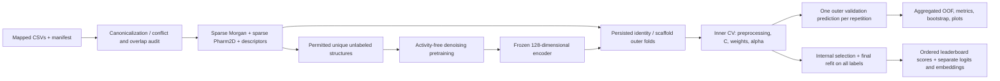

# Architecture and formulation

## Data flow

`data.py` owns activity label boundaries and chemical identity. `features.py` owns deterministic label-free representations and trainable projection/scaling utilities. `pretraining.py` consumes `FeatureBundle`, which has no target field. `models.py` owns supervised transformations. `cross_validation.py` constructs and persists common folds and performs all inner selection. `inference.py` owns the deployment artifact and validation. The CLI orchestrates these modules without adding model logic.

## Representations

Morgan ECFP4 uses radius 2, 2,048 binary positions, RDKit's default Morgan atom invariants and `includeChirality=False` (the RDKit generator default). Identity still distinguishes stereoisomers. Morgan collisions are inherent in the finite bit vector. Pharmacophores use the built-in [Gobbi–Poppinger RDKit Pharm2D feature factory](https://www.rdkit.org/docs/source/rdkit.Chem.Pharm2D.Gobbi_Pharm2D.html), with its native feature families, topological-distance bins and 2/3-point combinations. Active native positions `i` map to:

`int.from_bytes(SHA256(str(i).encode('ascii'))[:8], 'big') % 1024`.

All positions mapping to a hashed bit are combined with binary OR. This scheme is deterministic across runs/processes and can collide. Pharm2D models topological pharmacophore relationships, not measured 3D geometry. Feature configuration, RDKit version and implementation version participate in cache identities.

Twenty descriptors are molecular weight, LogP, TPSA, HBD, HBA, rotatable bonds, heavy atoms, rings, aromatic rings, fraction Csp3, aliphatic rings, heteroatoms, NHOH count, NO count, molar refractivity, Labute ASA, Balaban J, Bertz complexity, formal charge and valence electrons. Descriptor calculation failures/non-finite values become missing values. A training-fitted median imputer and standard scaler preserve all columns, replacing entirely missing columns by zero. Descriptor noise and reconstruction operate in normalized coordinates.

Fingerprints are cached as `uint8` CSR matrices, descriptors as float32. Only each autoencoder minibatch is converted to dense float32; no whole-collection dense fingerprint tensor is created. Feature extraction works in chunks with configurable joblib workers. Aggregate cache keys include sorted structure identity and canonical strings; changing a molecular set creates a new cache artifact.

## Denoising encoder

Let `b` be the 3,072-dimensional combined binary fingerprint and `d` the normalized descriptors. The fingerprint encoder is `3072 → 512 → 128` with GELU, layer normalization and dropout; the descriptor projection is `20 → 32`. Concatenation is projected from 160 to the configurable latent dimension (128 by default), followed by layer normalization and GELU. The fingerprint decoder is `128 → 512 → 3072`; the descriptor decoder is `128 → 64 → 20`.

Training masks active fingerprint bits at rate 0.15 and independently flips bits at rate 0.002, with Gaussian descriptor noise of SD 0.05 by default. Targets remain the clean original inputs. Validation uses uncorrupted inputs for deterministic clean reconstruction early stopping. There are no activity labels, activity-guided hyperparameters or supervised fine-tuning.

The loss is mean bitwise weighted binary cross-entropy plus normalized descriptor mean squared error:

`L = mean_j[-w_j b_j log(sigmoid(r_j)) - (1-b_j) log(1-sigmoid(r_j))] + beta * mean_l[(d_l-dhat_l)^2]`.

`w_j = clip((N_train - count_j) / max(count_j,1), 1, cap)` uses unsupervised training rows only, with cap 100. Unobserved training bits have weight 1. Weighting and corruption discourage a trivial all-zero reconstruction but cannot guarantee useful representations; a near-zero fingerprint-loss reference and density/weight diagnostics are saved. Early stopping monitors validation total reconstruction loss with patience 7; the best state is restored. The normalization object, exact structure split, history and weights are persisted. The frozen encoder is in eval mode with all gradients disabled when extracting embeddings.

## Supervised branches and fusion

For a given branch representation `phi`, L2 logistic regression minimizes the weighted logistic loss plus its regularizer. `C` controls inverse regularization; class weights are explicitly `{negative:1, positive:w}`. The default grids are `C∈{0.01,0.1,1}` and `w∈{1,10,20}`. The liblinear solver uses L2 regularization, fixed seeds and explicit maximum iterations; convergence warnings fail the run rather than silently accepting an unconverged model.

`z_A = w_A^T [ECFP, scale_train(descriptors)] + intercept_A`.

`z_B = w_B^T [scale_train(h(x)), scale_train(descriptors)] + intercept_B`.

`z_C = (1-alpha) z_A + alpha z_B`, `score_C = sigmoid(z_C)`.

Each branch is selected using its pooled inner OOF AP. Alpha is selected from the two chosen branches' inner OOF logits, using AP and the configured scalar grid; the first candidate wins an exact tie. Reusing inner OOF values for multiple training-only selection choices can overfit the inner criterion, which is why only untouched outer predictions are used for reported evaluation. Outer preprocessing, classifier refits and fusion have no access to outer-validation activities. Global label-free pretraining is disclosed separately.

The final model repeats internal grouped CV on all labels and refits both branches. It does not carry outer-fold fitted scalers into the deployment model. Optional branch-only scores use the same persisted predictor. There is no post-hoc probability calibration.

## Splits and uncertainty

[StratifiedGroupKFold](https://scikit-learn.org/stable/modules/generated/sklearn.model_selection.StratifiedGroupKFold.html) approximately preserves class proportions while keeping groups disjoint. The implementation retries deterministic seeds, reduces fold counts where necessary and fails if no binary train/validation split exists. Scaffold groups are conservative Bemis–Murcko skeletons without chirality, and empty skeletons form a common acyclic group. Scaffolds with different decoration patterns can still be chemically related; scaffold validation is a particular extrapolation test, not proof of distributional independence.

Outer identity/scaffold assignments are stored with signatures of ordered row identities/labels and split configuration. Every model and repeat uses those assignments. Inner assignments are also exported. Changes in representation do not change the outer splits.

For repeated CV, `z_bar_i = mean_r z_i,r` is the sole pooled prediction for molecule `i`. Evaluation resamples canonical structure clusters for percentile bootstrap intervals without refitting models. Fold SD describes variation among correlated folds and must not be interpreted as an independent-sample standard error. The few positives constrain inference about all performance differences.

## Future extension boundary

The `ClassicalInterface` protocol supplies a frozen classical logit, embedding, pharmacophore vector and ranking score per molecule. A future residual learner can consume these exports and implement `z_hybrid = z_classical + lambda r_quantum`. It must honor saved folds and fit reduction/angle scaling, kernel settings, residual labels and lambda inside the appropriate training partition. `CompactProjector` is an ordinary classical SVD/PCA utility, not a simulated quantum model. No placeholder residual, kernel or quantum performance is included.

## Independent-model extension

`representations.py` supplies label-free `MolecularInputs` with sparse binary and count representations. `model_zoo.py` implements per-model trainable preprocessing, optional tree backends, Tanimoto SVM and complete inner-OOF selection. `chemprop_model.py` provides a real optional supervised graph network with portable CPU state bytes. `ensemble.py` provides fixed and conservatively selected rank ensembles. `experiments.py` orchestrates shared outer folds, per-model refits, prediction exports and protected run names; `selection.py` applies fixed label-free diversity policies.

All legacy modules and checkpoint formats remain supported. M0/M1/M2 in the new suite implement the corresponding baseline definitions. Different parameter grids can select different models; the suite's development grids are not claimed to reproduce prior development metrics. M3 keeps scalar inner-OOF logit fusion. M16/M17 instead use smoothed CDFs fitted to inner OOF logits to place differently scaled learners on comparable ranking coordinates. These are ranking normalizations, not probability calibration.

The graph model has no implicit holdout: fixed epochs optimize all rows passed by the nested runner, with epoch/weight choices evaluated only in inner folds. Its member predictions are averaged as scores. Positive class weights affect the supervised training loss, not labels or split construction. No unsupervised-molecule negative labels, pretrained weights, docking structures, synthetic positive bioisosteres or quantum residuals are generated.
